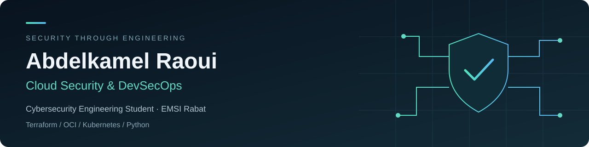

  

  <a href="https://abdelkamel.me">Portfolio</a> &nbsp; · &nbsp;
  <a href="https://www.linkedin.com/in/abdelkamel-raoui-816077279/">LinkedIn</a> &nbsp; · &nbsp;
  <a href="mailto:abdelkamelraoui@outlook.com">Contact</a>

### Building secure systems. Learning through practice.

I'm **Abdelkamel Raoui**, a final-year cybersecurity engineering student at **EMSI Rabat**, Morocco. My interests sit at the intersection of **cloud security, infrastructure automation and DevSecOps**.

My IT/OT cybersecurity internship at **Pfizer** helped me connect technical security findings with operational constraints. Through my personal projects, I explore how to build reproducible infrastructure and verify security controls through practical tests.

**Currently seeking a six-month final-year internship (PFE) from January/February 2027 in Cloud Security, DevOps or DevSecOps.**

### Selected projects

| Project | Focus | Explore |
| :--- | :--- | :--- |
| **CloudGuard-X** | Personal Zero Trust cloud security prototype: Terraform, private OCI/OKE infrastructure, scoped IAM, Vault/KMS and Kubernetes hardening. NetworkPolicy isolation tested with OCI VCN-native and Calico policy-only. | [Repository](https://github.com/RaouiAbdelkamel/cloudguard-x) · [Architecture](https://github.com/RaouiAbdelkamel/cloudguard-x/blob/main/docs/ARCHITECTURE.md) · [Validation](https://github.com/RaouiAbdelkamel/cloudguard-x/blob/main/docs/SECURITY-VALIDATION-SUMMARY.md) |
| **DevSecOps Pipeline** | Academic project exploring CI/CD security controls: SAST, DAST, SCA, secret detection, IaC and container scanning. | [Repository](https://github.com/RaouiAbdelkamel/pfa-devsecops-pipeline) |

CloudGuard-X is a **personal engineering prototype**, not a production-ready platform. Its public documentation distinguishes implemented controls, recorded validation results and remaining limitations.

### My technical toolkit

| Area | Technologies and practices |
| :--- | :--- |
| **Cloud & infrastructure** | OCI · Terraform · VCN segmentation · IAM · Vault/KMS |
| **Containers & delivery** | Docker · Kubernetes / OKE · GitHub Actions · CI/CD · Calico NetworkPolicy |
| **Security checks** | Trivy · Checkov · Gitleaks · Syft / SBOM · SAST / SCA |
| **Systems & networking** | Linux · Windows · Cisco IOS · FortiGate · IKEv2/IPSec · Wireshark |
| **Development** | Python · FastAPI · Git |
| **IT/OT risk** | IEC 62443 · NIST CSF 2.0 · MITRE ATT&CK for ICS |

### Background

- **Cybersecurity engineering studies**, EMSI Rabat — expected graduation in 2027.
- **Oracle Cloud Infrastructure DevOps Professional** certification — 2026.
- **IT/OT cybersecurity internship**, Pfizer — 2026.
- **Python development and industrial data analysis internship**, OCP Jorf Lasfar — 2024.
- Languages: French, Arabic and English.

### Let's connect

I'm interested in teams where I can contribute, learn from experienced engineers and take on practical cloud and security challenges.

[Portfolio](https://abdelkamel.me) · [LinkedIn](https://www.linkedin.com/in/abdelkamel-raoui-816077279/) · [abdelkamelraoui@outlook.com](mailto:abdelkamelraoui@outlook.com)
